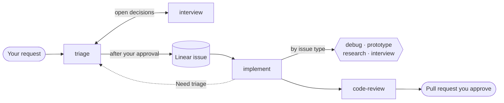

# agent-skills

An opinionated development method for coding agents: every change starts as an
approved Linear issue, ships test-first, passes an independent review, and reaches
a pull request only when you say so.

[](https://skills.sh/Firzus/agent-skills)
[](./LICENSE)

The method is a set of skills that call each other. Next to it, the collection
offers standalone skills for engineering, web, and game work that you can install
one at a time. These are independent, community-maintained skills, not official
vendor products.

[The method](#the-method) · [How it works](#how-it-works) · [Get started](#get-started) · [Choose by task](#choose-by-task) · [Requirements](#requirements) · [All skills](#all-skills) · [Contribute](#contribute)

## The method

Agents fail in predictable ways: they build before the decision is made, ask you
what the repository already says, grade their own work, and publish without asking.
The method answers each failure with a rule.

- **No issue, no code.** Every request, even a small one, goes through `triage`
  and becomes a Linear issue. `implement` refuses to work without one.
- **Facts are looked up; only decisions are asked.** The agent reads the
  repository, Linear, and the documentation before asking you anything. You answer
  only choices that change scope, acceptance, or structure.
- **Decide before building.** When a decision needs evidence, triage plans a
  Research or Prototype issue first, then an Interview issue that settles the
  decision with that evidence.
- **Tests first.** Each behavior starts with a failing test wherever a test
  boundary exists.
- **Evidence over claims.** Independent read-only reviewers check requirements,
  standards, and correctness. Agreement between agents is not proof; the
  implementing agent verifies every finding.
- **You hold the keys.** Publishing issues, opening a pull request, merging, and
  deploying each wait for your explicit approval.
- **One policy, focused skills.** General rules (authorization, delegation,
  verification, Git conventions, code comments) live once in a [shared
  operating policy](./skills/engineering/setup-harness/references/operating-policy.md).
  Skills hold only what is specific to their task.

## How it works



`triage` finds existing work, picks the issue type, settles open decisions through
`interview`, and publishes the issues in Todo once you approve the drafts.
`implement` then runs one issue at a time and routes it by type:

| Issue type | What `implement` runs | Done when |
| --- | --- | --- |
| Task | Test-first implementation, then the `code-review` loop | Its pull request merges |
| Bug | `debug` to reproduce and fix, then the `code-review` loop | Its pull request merges |
| Prototype | `prototype` to answer the question with an observable experiment | You validate the result |
| Research | `research` with a reusable evidence dossier | The report is published on the issue |
| Interview | `interview` with the results of the issues it waited for | You confirm the decisions |

Work that would change an issue's outcome or scope goes back to `triage` with the
**Need triage** label instead of growing inside the current issue.
`improve-architecture` feeds the same loop: it publishes approved refactors as
Task issues ready for `implement`.

## Get started

You need a coding agent that supports skills and subagents, Node.js and npm for
the installer, and a Linear workspace your agent can reach.

1. Open a terminal in your project and install the method:

   ```bash
   npx skills add Firzus/agent-skills --skill setup-harness triage interview implement debug prototype research code-review improve-architecture
   ```

   The installer asks for your agent and destination. It installs in the project
   by default; add `-g` to install globally.

2. Run **setup-harness** once. It installs the shared operating policy in your
   personal instructions, after showing you the complete change. The method
   relies on it.
3. Run **triage** on a small request. Review the drafted issue and approve its
   publication.
4. Run **implement** on the published issue. It asks you to validate opening the
   pull request once the work is verified.

If an invoked skill is not found, check the installation location and restart the
session.

<details>
<summary>Browse, update, or remove installed skills</summary>

```bash
# Browse the collection without installing it
npx skills add Firzus/agent-skills --list

# Choose skills interactively
npx skills add Firzus/agent-skills

# Manage installed skills
npx skills list
npx skills update implement
npx skills remove implement
```

See the [skills CLI documentation](https://github.com/vercel-labs/skills)
for supported agents, installation modes, and troubleshooting.

</details>

## Choose by task

Some skills work on their own, without Linear or the rest of the method.

| I want to… | Start with | Needs the method |
| --- | --- | --- |
| Turn a request into approved Linear work | [triage](./skills/engineering/triage/SKILL.md) | Yes |
| Execute a published Linear issue | [implement](./skills/engineering/implement/SKILL.md) | Yes |
| Find refactors worth planning | [improve-architecture](./skills/engineering/improve-architecture/SKILL.md) | Yes |
| Review an existing change without modifying it | [code-review](./skills/engineering/code-review/SKILL.md) | No |
| Diagnose a bug or verify an authorized fix | [debug](./skills/engineering/debug/SKILL.md) | No |
| Compare interface ideas or test feasibility | [prototype](./skills/engineering/prototype/SKILL.md) | No |
| Investigate a question across multiple sources | [research](./skills/engineering/research/SKILL.md) | No |
| Audit security boundaries in a codebase | [security-review](./skills/engineering/security-review/SKILL.md) | No |
| Explain how shipped software works from its files | [reverse-engineer](./skills/engineering/reverse-engineer/SKILL.md) | No |

Engineering skills still assume the shared operating policy, even when used alone.

## Requirements

Installing instructions does not install every tool they describe or authorize
every action they can perform. Check the selected skill's prerequisites first.

| Workflow | Additional requirements |
| --- | --- |
| Engineering skills | The shared operating policy installed by [setup-harness](#personal-harness-instructions); these skills rely on it and repeat only its safety boundaries |
| The method (triage, implement, improve-architecture) | A Linear workspace your agent can read and write, with approval for external writes |
| Independent reviews and delegated research | An agent with subagent support |
| Figma workflows | The Figma integration, account access, and approval for external writes |
| Chrome debugging and automation | Google Chrome and the `chrome-devtools` CLI from the npm package `chrome-devtools-mcp`; the skill proposes the global install and waits for approval |
| Cloudflare operations | The `cf` CLI from the npm package `cf` (open beta) and a Cloudflare account; the skill proposes the global install and waits for approval |
| Video reports | FFmpeg and access to the application being recorded |
| Runbooks | Bash to run them (Git Bash on Windows); an authenticated GitHub CLI to set secrets and variables, otherwise the runbook lists them to set by hand |
| YouTube transcription | Available captions, or the audio/transcription tools required by the selected route |
| Image generation | An authenticated Codex CLI setup with the image-generation capability described by the skill |
| Reverse engineering | The reverse-engineer MCP server for the fast route (Node.js 24.11+); the skill installs Ghidra, jadx or ilspycmd per user when a task needs them |

Host support for installing skills does not guarantee identical behavior or tool
availability. Explicit-invocation workflows such as **triage**, **interview**,
**implement**, **improve-architecture**, and **setup-harness** run only when you
select them.

### Personal harness instructions

[setup-harness](./skills/engineering/setup-harness/SKILL.md) asks which harnesses
and languages to configure, previews the complete changes, and waits for approval.
It adds personal instructions without replacing the built-in system prompt and
creates no backups. Existing unrelated instructions are preserved.

| Harness | Personal instruction destination |
| --- | --- |
| Codex (app and CLI) | One shared `AGENTS.md` per `CODEX_HOME` (default `~/.codex`) |
| Cursor | User Rules in Customize > Rules; manual handoff if UI editing is unavailable |
| Claude Code | `~/.claude/CLAUDE.md` |

Cursor's project `AGENTS.md` is not a global substitute. See the
[native destinations](./skills/engineering/setup-harness/references/harnesses.md)
for loading limits, and review the
[shared operating policy](./skills/engineering/setup-harness/references/operating-policy.md)
before running this skill.

### Tauri companion tooling

The [tauri](./skills/web/tauri/SKILL.md) skill remains the agent-facing entry
point. Its optional Windows diagnostic application, [tauri-agent-kit](./mcp/tauri-agent-kit/README.md),
is maintained in this repository but is not an installable skill. Installing the
skill does not install the MCP server or Rust plugin: the skill proposes the
integration when a compatible project lacks it, and installs it only after
approval. Check the kit's compatibility and publication status before integrating
it into an application.

### Reverse-engineer companion server

The [reverse-engineer](./skills/engineering/reverse-engineer/SKILL.md) skill works
with shell commands alone, but it is faster and more economical with its read-only
MCP server, [mcp/reverse-engineer](./mcp/reverse-engineer/README.md). Installing
the skill does not install the server: register its npm package, `reverse-engineer`
(alpha), with your agent, as described in its README.

## All skills

### Engineering

| Skill | Purpose |
| --- | --- |
| [chrome-devtools](./skills/engineering/chrome-devtools/SKILL.md) | Debug and automate Chrome from the shell: console, network, cookies, performance, accessibility, and memory. |
| [code-review](./skills/engineering/code-review/SKILL.md) | Independent read-only review of a scoped change. |
| [debug](./skills/engineering/debug/SKILL.md) | Evidence-led diagnosis and verification of authorized bug fixes. |
| [gamification](./skills/engineering/gamification/SKILL.md) | Engagement mechanics, motivation, and ethical design checks. |
| [imagegen](./skills/engineering/imagegen/SKILL.md) | Generate or edit raster images through Codex. |
| [implement](./skills/engineering/implement/SKILL.md) | Execute a published Linear issue by work type, with tests. |
| [improve-architecture](./skills/engineering/improve-architecture/SKILL.md) | Find architectural friction and publish approved refactors as Linear sub-issues. |
| [interview](./skills/engineering/interview/SKILL.md) | Resolve decisions through question rounds until the agreed scope and consequential edge cases are covered. |
| [monorepo](./skills/engineering/monorepo/SKILL.md) | Workspace structure, package boundaries, task graphs, caching, affected CI, and release verification. |
| [prototype](./skills/engineering/prototype/SKILL.md) | Answer a design or feasibility question through an experiment. |
| [research](./skills/engineering/research/SKILL.md) | Multi-source investigation with a reusable evidence dossier. |
| [reverse-engineer](./skills/engineering/reverse-engineer/SKILL.md) | Explain shipped software (Electron apps, native binaries and Node addons, Go/Rust, .NET, APK) from its files, with cited evidence and an optional read-only MCP server. |
| [runbook](./skills/engineering/runbook/SKILL.md) | Write an interactive bash runbook that guides a person through manual setup, credentials, or a cutover. |
| [setup-harness](./skills/engineering/setup-harness/SKILL.md) | Install the shared operating policy as reviewed personal instructions for selected harnesses. |
| [security-review](./skills/engineering/security-review/SKILL.md) | Investigate codebase security boundaries and report evidence-backed findings. |
| [skills](./skills/engineering/skills/SKILL.md) | Discover, install, maintain, and author agent skills. |
| [triage](./skills/engineering/triage/SKILL.md) | Turn a request into approved Linear issues or projects, clarified through interview, and continue a project goal by goal. |
| [unslop](./skills/engineering/unslop/SKILL.md) | Propose evidenced dead-code and slop removals in the conversation, then apply the accepted ones. |
| [video-report](./skills/engineering/video-report/SKILL.md) | Record video evidence of real application behavior. |
| [writing-for-agents](./skills/engineering/writing-for-agents/SKILL.md) | Write useful skills and project instructions. |
| [youtube-transcript](./skills/engineering/youtube-transcript/SKILL.md) | Turn video speech and visual evidence into a learning report. |

### Web and app development

| Skill | Purpose |
| --- | --- |
| [adsense](./skills/web/adsense/SKILL.md) | Publisher monetization, ad placement, policy, and performance. |
| [astryx](./skills/web/astryx/SKILL.md) | Build interfaces with the Astryx design system. |
| [cloudflare-cli](./skills/web/cloudflare-cli/SKILL.md) | Operate Cloudflare resources and Workers projects through the `cf` CLI. |
| [dokploy-best-practices](./skills/web/dokploy-best-practices/SKILL.md) | Deploy and operate applications with Dokploy. |
| [extract-theme](./skills/web/extract-theme/SKILL.md) | Extract a website's design tokens for Tailwind and shadcn/ui. |
| [nextjs](./skills/web/nextjs/SKILL.md) | Build and migrate Next.js applications. |
| [payload-cms](./skills/web/payload-cms/SKILL.md) | Model content, access rules, and hooks with Payload CMS. |
| [shaders](./skills/web/shaders/SKILL.md) | Add GPU-driven visual effects to React interfaces. |
| [swr](./skills/web/swr/SKILL.md) | Manage React data fetching, caching, and mutations. |
| [tanstack-query](./skills/web/tanstack-query/SKILL.md) | Manage asynchronous server state with TanStack Query. |
| [tanstack-router](./skills/web/tanstack-router/SKILL.md) | Build type-safe routes with TanStack Router. |
| [tanstack-start](./skills/web/tanstack-start/SKILL.md) | Build full-stack applications with TanStack Start. |
| [tanstack-store](./skills/web/tanstack-store/SKILL.md) | Manage reactive client state with TanStack Store. |
| [tauri](./skills/web/tauri/SKILL.md) | Build and validate Tauri desktop and mobile applications. |
| [vite-plus](./skills/web/vite-plus/SKILL.md) | Configure Vite+ tooling, checks, and workspace tasks. |
| [web-assets-optimization](./skills/web/web-assets-optimization/SKILL.md) | Optimize images, video, fonts, SVG, and asset delivery. |
| [web-extension](./skills/web/web-extension/SKILL.md) | Build and package browser extensions. |
| [zod](./skills/web/zod/SKILL.md) | Validate data and evolve schemas with Zod. |

### Game development

| Skill | Purpose |
| --- | --- |
| [figma-to-unity](./skills/game/figma-to-unity/SKILL.md) | Implement Figma designs in Unity UI Toolkit. |
| [unity](./skills/game/unity/SKILL.md) | Choose the appropriate tools for Unity development tasks. |

## Contribute

Found a problem? [Open an issue](https://github.com/Firzus/agent-skills/issues)
with the skill name, agent and version, expected result, and actual result.
Remove secrets and private project data from examples.

For repository changes, read [AGENTS.md](./AGENTS.md) for contribution boundaries
and validation. A skill lives at `skills/<section>/<name>/SKILL.md`; supporting
references and helpers stay in its folder. Keep the README catalog and
[marketplace manifest](./.claude-plugin/marketplace.json) aligned with skill folders.

Licensed under [MIT](./LICENSE).
