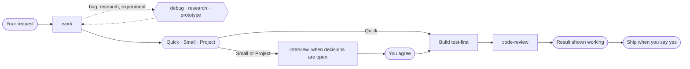

# agent-skills

An opinionated development stack for coding agents: you describe what you want,
the agent asks only the decisions that are yours, builds it test-first, has it
reviewed independently, shows it working, and ships only when you say so.

[](https://skills.sh/Firzus/agent-skills)
[](./LICENSE)

The stack is a set of skills that call each other, kept in
[`skills/stack/`](./skills/stack). Next to it, the collection offers standalone
skills for engineering, web, and game work that you can install one at a time.
These are independent, community-maintained skills, not official vendor products.

[The stack](#the-stack) · [How it works](#how-it-works) · [Get started](#get-started) · [Choose by task](#choose-by-task) · [Requirements](#requirements) · [All skills](#all-skills) · [Contribute](#contribute)

## The stack

Agents fail in predictable ways: they build before understanding the request, ask
you what the repository already says, grade their own work, bury you in jargon or
in ceremony, and publish without asking. The stack answers each failure with an
opinion.

- **Understand before building.** The agent restates the outcome and how you will
  both know it works before it changes any code.
- **Facts are looked up; only your decisions are asked.** The agent reads the code,
  history, and documentation first. It asks only about choices you own (behavior,
  scope, cost, a step that is hard to undo) and takes the technical ones itself,
  telling you which it took and why.
- **Ceremony matches the work.** The agent sizes each request as Quick, Small, or
  Project and tells you why. A typo needs no issue; a feature gets one; a large
  effort gets a project.
- **No agreement, no code.** Beyond a Quick fix, the agent builds only what you
  agreed to.
- **Linear holds the work.** Each feature or fix is a Linear issue and each large
  effort a Linear project, written so that any later session continues from it.
- **One unit at a time.** Large work advances in units that one session can
  finish, check, and hand over as a change you can review in one sitting. The
  agent plans only as far as what is known, and takes stock with you whenever a
  result changes the way ahead.
- **Tests first.** Each behavior starts with a failing test wherever a test
  boundary exists.
- **Evidence over claims.** Independent read-only reviewers check requirements,
  standards, and correctness, and the agent shows you the result running.
- **Explained, not simplified.** The agent keeps the real technical terms, defines
  each one the first time it appears, and presents every decision with its costs,
  whether it can be undone, and a recommendation.
- **You hold the keys.** Shipping (push and pull request), merging, and deploying
  each wait for your explicit yes.

General rules (communication, authorization, delegation, verification, Git) live
once in a [shared operating policy](./skills/engineering/setup-harness/references/operating-policy.md);
each skill holds only what is specific to its task.

## How it works



You start everything with `/work` and your request, in your own words. The agent
first finds the cause of a bug or gathers the evidence a decision needs, then sizes
the work:

| Size | When | What you do |
| --- | --- | --- |
| Quick | The request says everything that matters and is easy to undo | Check the result, then say whether to ship |
| Small | One unit: fits one session and one reviewable change | Answer the decisions, agree on the Linear issue, check the result, say whether to ship |
| Project | Several units, or questions that need research, an experiment, or a later decision first | Agree on a Linear project and its first issues; then run `/work` on the project: the agent works through the units, comes back for your decisions and reviews, and takes stock with you when results change the plan |

Small and Project work need Linear: when the agent cannot reach it, it stops and
tells you how to reconnect. Quick work does not use Linear.

## Get started

You need a coding agent that supports skills and subagents, and Node.js and npm
for the installer.

1. Open a terminal in your project and install the stack:

   ```bash
   npx skills add Firzus/agent-skills --skill setup-harness work interview debug prototype research code-review
   ```

   The installer asks for your agent and destination. It installs in the project
   by default; add `-g` to install globally.

2. Run **setup-harness** once. It installs the shared operating policy in your
   personal instructions, after showing you the complete change. The stack
   relies on it.
3. Run **/work** with a small request, for example `/work fix the typo in the
   confirmation email`. Check the result it shows you, then tell it whether to ship.

If an invoked skill is not found, check the installation location and restart the
session.

<details>
<summary>Browse, update, or remove installed skills</summary>

```bash
# Browse the collection without installing it
npx skills add Firzus/agent-skills --list

# Choose skills interactively
npx skills add Firzus/agent-skills

# Manage installed skills
npx skills list
npx skills update work
npx skills remove work
```

See the [skills CLI documentation](https://github.com/vercel-labs/skills)
for supported agents, installation modes, and troubleshooting.

</details>

## Choose by task

Some skills work on their own, without the rest of the stack.

| I want to… | Start with | Needs the stack |
| --- | --- | --- |
| Take a request from idea to a shipped change | [work](./skills/stack/work/SKILL.md) | Yes |
| Settle open decisions on a plan or feature | [interview](./skills/stack/interview/SKILL.md) | No |
| Review an existing change without modifying it | [code-review](./skills/stack/code-review/SKILL.md) | No |
| Diagnose a bug or verify an authorized fix | [debug](./skills/stack/debug/SKILL.md) | No |
| Compare interface ideas or test feasibility | [prototype](./skills/stack/prototype/SKILL.md) | No |
| Investigate a question across multiple sources | [research](./skills/stack/research/SKILL.md) | No |
| Find refactors worth doing | [improve-architecture](./skills/engineering/improve-architecture/SKILL.md) | No |
| Audit security boundaries in a codebase | [security-review](./skills/engineering/security-review/SKILL.md) | No |
| Explain how shipped software works from its files | [reverse-engineer](./skills/engineering/reverse-engineer/SKILL.md) | No |

Stack and engineering skills assume the shared operating policy, even when used alone.

## Requirements

Installing instructions does not install every tool they describe or authorize
every action they can perform. Check the selected skill's prerequisites first.

| Workflow | Additional requirements |
| --- | --- |
| Stack and engineering skills | The shared operating policy installed by [setup-harness](#personal-harness-instructions); these skills rely on it and repeat only its safety boundaries |
| The stack | Git in the project; a Linear workspace the agent can read and write (for example through the Linear MCP server) for Small and Project work; GitHub CLI or another way to open pull requests to ship |
| Independent reviews and delegated research | An agent with subagent support |
| Figma workflows | The Figma integration, account access, and approval for external writes |
| Chrome debugging and automation | Google Chrome and the `chrome-devtools` CLI from the npm package `chrome-devtools-mcp`; the skill proposes the global install and waits for approval |
| Cloudflare operations | The `cf` CLI from the npm package `cf` (open beta) and a Cloudflare account; the skill proposes the global install and waits for approval |
| Video reports | FFmpeg and access to the application being recorded |
| Runbooks | Bash to run them (Git Bash on Windows); an authenticated GitHub CLI to set secrets and variables, otherwise the runbook lists them to set by hand |
| YouTube transcription | Available captions, or the audio/transcription tools required by the selected route |
| Image generation | An authenticated Codex CLI setup with the image-generation capability described by the skill |
| Reverse engineering | The reverse-engineer MCP server for the fast route (Node.js 24.11+); the skill installs Ghidra, jadx or ilspycmd per user when a task needs them |

Host support for installing skills does not guarantee identical behavior or tool
availability. Explicit-invocation workflows such as **work**, **improve-architecture**, and
**setup-harness** run only when you select them.

### Personal harness instructions

[setup-harness](./skills/engineering/setup-harness/SKILL.md) asks which harnesses
and languages to configure, previews the complete changes, and waits for approval.
It adds personal instructions without replacing the built-in system prompt and
creates no backups. Existing unrelated instructions are preserved.

| Harness | Personal instruction destination |
| --- | --- |
| Codex (app and CLI) | One shared `AGENTS.md` per `CODEX_HOME` (default `~/.codex`) |
| Cursor | User Rules in Customize > Rules; manual handoff if UI editing is unavailable |
| Claude Code | `~/.claude/CLAUDE.md` |

Cursor's project `AGENTS.md` is not a global substitute. See the
[native destinations](./skills/engineering/setup-harness/references/harnesses.md)
for loading limits, and review the
[shared operating policy](./skills/engineering/setup-harness/references/operating-policy.md)
before running this skill.

### Tauri companion tooling

The [tauri](./skills/web/tauri/SKILL.md) skill remains the agent-facing entry
point. Its optional Windows diagnostic application, [tauri-agent-kit](./mcp/tauri-agent-kit/README.md),
is maintained in this repository but is not an installable skill. Installing the
skill does not install the MCP server or Rust plugin: the skill proposes the
integration when a compatible project lacks it, and installs it only after
approval. Check the kit's compatibility and publication status before integrating
it into an application.

### Reverse-engineer companion server

The [reverse-engineer](./skills/engineering/reverse-engineer/SKILL.md) skill works
with shell commands alone, but it is faster and more economical with its read-only
MCP server, [mcp/reverse-engineer](./mcp/reverse-engineer/README.md). Installing
the skill does not install the server: register its npm package, `reverse-engineer`
(alpha), with your agent, as described in its README.

## All skills

### Stack

| Skill | Purpose |
| --- | --- |
| [code-review](./skills/stack/code-review/SKILL.md) | Independent read-only review of a change on requirements, standards, and correctness. |
| [debug](./skills/stack/debug/SKILL.md) | Evidence-led diagnosis and verification of authorized bug fixes. |
| [interview](./skills/stack/interview/SKILL.md) | Settle the user's decisions in short question rounds, each explained and with a recommendation. |
| [prototype](./skills/stack/prototype/SKILL.md) | Answer a design or feasibility question through an experiment. |
| [research](./skills/stack/research/SKILL.md) | Multi-source investigation with a reusable evidence dossier. |
| [work](./skills/stack/work/SKILL.md) | Entry point: size a request, settle decisions, build test-first, review, show, and ship on approval. |

### Engineering

| Skill | Purpose |
| --- | --- |
| [authoring](./skills/engineering/authoring/SKILL.md) | Write and review skills, their invocation conditions, references, and templates. |
| [chrome-devtools](./skills/engineering/chrome-devtools/SKILL.md) | Debug and automate Chrome from the shell: console, network, cookies, performance, accessibility, and memory. |
| [gamification](./skills/engineering/gamification/SKILL.md) | Engagement mechanics, motivation, and ethical design checks. |
| [imagegen](./skills/engineering/imagegen/SKILL.md) | Generate or edit raster images through Codex. |
| [improve-architecture](./skills/engineering/improve-architecture/SKILL.md) | Find architectural friction and propose evidenced refactors that preserve behavior. |
| [instructions](./skills/engineering/instructions/SKILL.md) | Write and review project instructions and other agent-facing documentation outside skills. |
| [monorepo](./skills/engineering/monorepo/SKILL.md) | Workspace structure, package boundaries, task graphs, caching, affected CI, and release verification. |
| [reverse-engineer](./skills/engineering/reverse-engineer/SKILL.md) | Explain shipped software (Electron apps, native binaries and Node addons, Go/Rust, .NET, APK) from its files, with cited evidence and an optional read-only MCP server. |
| [runbook](./skills/engineering/runbook/SKILL.md) | Write an interactive bash runbook that guides a person through manual setup, credentials, or a cutover. |
| [setup-harness](./skills/engineering/setup-harness/SKILL.md) | Install the shared operating policy as reviewed personal instructions for selected harnesses. |
| [security-review](./skills/engineering/security-review/SKILL.md) | Investigate codebase security boundaries and report evidence-backed findings. |
| [skills](./skills/engineering/skills/SKILL.md) | Discover, install, maintain, and author agent skills. |
| [unslop](./skills/engineering/unslop/SKILL.md) | Propose evidenced dead-code and slop removals in the conversation, then apply the accepted ones. |
| [video-report](./skills/engineering/video-report/SKILL.md) | Record video evidence of real application behavior. |
| [youtube-transcript](./skills/engineering/youtube-transcript/SKILL.md) | Turn video speech and visual evidence into a learning report. |

### Web and app development

| Skill | Purpose |
| --- | --- |
| [adsense](./skills/web/adsense/SKILL.md) | Publisher monetization, ad placement, policy, and performance. |
| [astryx](./skills/web/astryx/SKILL.md) | Build interfaces with the Astryx design system. |
| [cloudflare-cli](./skills/web/cloudflare-cli/SKILL.md) | Operate Cloudflare resources and Workers projects through the `cf` CLI. |
| [dokploy-best-practices](./skills/web/dokploy-best-practices/SKILL.md) | Deploy and operate applications with Dokploy. |
| [extract-theme](./skills/web/extract-theme/SKILL.md) | Extract a website's design tokens for Tailwind and shadcn/ui. |
| [nextjs](./skills/web/nextjs/SKILL.md) | Build and migrate Next.js applications. |
| [payload-cms](./skills/web/payload-cms/SKILL.md) | Model content, access rules, and hooks with Payload CMS. |
| [shaders](./skills/web/shaders/SKILL.md) | Add GPU-driven visual effects to React interfaces. |
| [swr](./skills/web/swr/SKILL.md) | Manage React data fetching, caching, and mutations. |
| [tanstack-query](./skills/web/tanstack-query/SKILL.md) | Manage asynchronous server state with TanStack Query. |
| [tanstack-router](./skills/web/tanstack-router/SKILL.md) | Build type-safe routes with TanStack Router. |
| [tanstack-start](./skills/web/tanstack-start/SKILL.md) | Build full-stack applications with TanStack Start. |
| [tanstack-store](./skills/web/tanstack-store/SKILL.md) | Manage reactive client state with TanStack Store. |
| [tauri](./skills/web/tauri/SKILL.md) | Build and validate Tauri desktop and mobile applications. |
| [vite-plus](./skills/web/vite-plus/SKILL.md) | Configure Vite+ tooling, checks, and workspace tasks. |
| [web-assets-optimization](./skills/web/web-assets-optimization/SKILL.md) | Optimize images, video, fonts, SVG, and asset delivery. |
| [web-extension](./skills/web/web-extension/SKILL.md) | Build and package browser extensions. |
| [zod](./skills/web/zod/SKILL.md) | Validate data and evolve schemas with Zod. |

### Game development

| Skill | Purpose |
| --- | --- |
| [figma-to-unity](./skills/game/figma-to-unity/SKILL.md) | Implement Figma designs in Unity UI Toolkit. |
| [unity](./skills/game/unity/SKILL.md) | Choose the appropriate tools for Unity development tasks. |

## Contribute

Found a problem? [Open an issue](https://github.com/Firzus/agent-skills/issues)
with the skill name, agent and version, expected result, and actual result.
Remove secrets and private project data from examples.

For repository changes, read [AGENTS.md](./AGENTS.md) for contribution boundaries
and validation. A skill lives at `skills/<section>/<name>/SKILL.md`; supporting
references and helpers stay in its folder. Keep the README catalog and
[marketplace manifest](./.claude-plugin/marketplace.json) aligned with skill folders.

Licensed under [MIT](./LICENSE).
